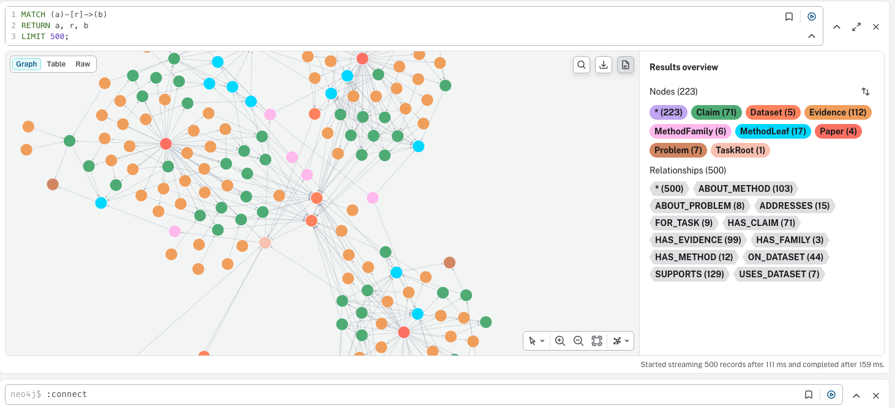
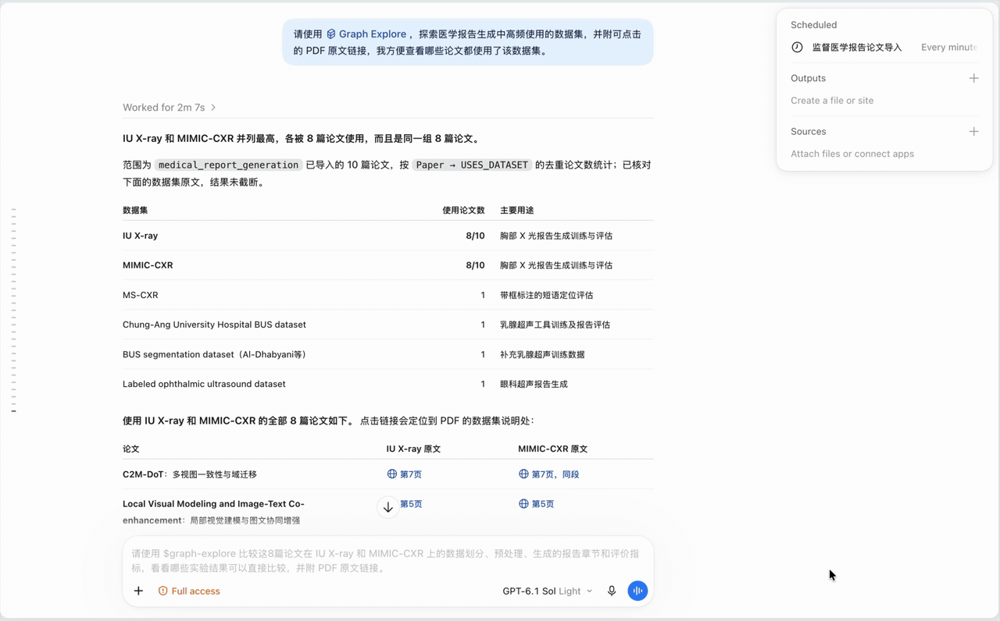
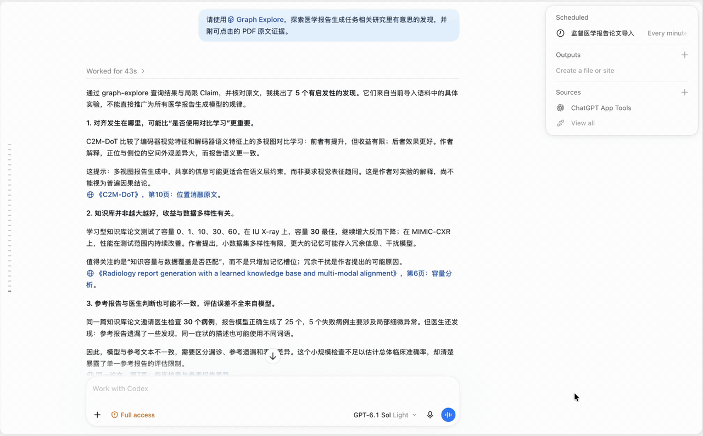

# Research OS

[English](README.md) | 简体中文

一个基于 MCP 和 Agent Skills 的科研工作台，支持批量论文导入、方法知识图谱探索，以及基于论文原文证据的算法 idea 生成。


## 效果展示

### 知识图谱探索



### PDF 原文证据



### 有证据支撑的研究 idea



## 快速开始

### 1. 准备环境

需要 Git、支持 Compose 的 Docker、uv、满足 [pyproject.toml](research-os-mcp/pyproject.toml) 要求的 Python、本机 MCP 客户端（例如 Codex），以及支持严格 JSON Schema 结构化输出的 OpenAI-compatible LLM 服务。以下命令使用兼容 Bash 的 shell。

```bash
git clone https://github.com/YangSuoze/research-os.git
cd research-os
```

### 2. 启动数据库

在仓库根目录运行：

```bash
docker compose up -d
docker compose ps
```

| 服务 | 本机地址 | 用途 |
| --- | --- | --- |
| Neo4j Browser | http://127.0.0.1:7474 | 查看科研知识图谱 |
| Elasticsearch | http://127.0.0.1:9200 | 存储论文 chunk，提供 BM25 检索 |

本地 Neo4j 默认用户名为 `neo4j`，密码为 `12345678`。修改 Compose 密码时，需要同步修改 MCP 配置。这些默认值仅用于本地开发：Elasticsearch 未启用认证，映射端口只绑定本机回环地址。

### 3. 配置 LLM

进入 MCP 项目，仅在 `.env` 尚不存在时创建：

```bash
cd research-os-mcp
if [ ! -e .env ] && [ ! -L .env ]; then
  cp .env.example .env
fi
```

编辑 `research-os-mcp/.env`，填写：

| 配置项 | 填写内容 |
| --- | --- |
| `BACKEND_LLM_BASE_URL` | 服务商提供的 OpenAI-compatible API base URL |
| `BACKEND_LLM_API_KEY` | API 密钥 |
| `BACKEND_MODEL_NAME` | 支持所需结构化输出的模型名称 |

默认本地部署可保留 [.env.example](research-os-mcp/.env.example) 中的其他值。`BACKEND_GITHUB_TOKEN` 可选，用于源码仓库搜索；`BACKEND_WORKSPACE_ROOT` 可通过绝对路径指定自定义存储目录。配置保留 `BACKEND_` 前缀是正常的。

### 4. 安装依赖并启动 MCP

在 `research-os-mcp` 目录运行：

```bash
uv sync --extra pdf --extra graph
uv run --extra pdf --extra graph python -m paper_import_mcp.server \
  --transport streamable-http --port 8002
```

保持该终端运行。MCP 地址为 `http://127.0.0.1:8002/mcp`，ES 索引与抽取阶段的并发上限默认为 5，可通过 `BACKEND_PAPER_EXTRACT_CONCURRENCY` 调整。

本指南明确使用 Streamable HTTP，以便原文证据返回可点击的 PDF 查看链接。服务默认 transport 为 stdio，该模式不提供 HTTP PDF 链接。stdio 配置和详细行为见 [MCP 使用说明](research-os-mcp/README.md)。

## 连接 Codex

保持 HTTP 服务运行，在另一个终端使用 Codex CLI 注册：

```bash
codex mcp add paper2graph --url http://127.0.0.1:8002/mcp
codex mcp list
```

也可以在客户端的本地 MCP 设置中，将名称设为 `paper2graph`，选择 Streamable HTTP，并填写相同 URL。配置方式参见 [Codex 官方 MCP 指南](https://learn.chatgpt.com/docs/extend/mcp?surface=cli)。

启用连接后，在下一轮对话中让智能体列出 `paper2graph` 工具，或调用 `get_graph_schema`。应能看到下文列出的八个工具；仅看到服务启动日志，不代表客户端已连接成功。


## 安装 Skills

| 技能 | 用途 |
| --- | --- |
| [paper-import](research-os-skills/paper-import/SKILL.md) | 导入 PDF、监督批次进度，以及在授权后重试失败论文 |
| [graph-explore](research-os-skills/graph-explore/SKILL.md) | 灵活调查关系、统计、跨任务知识和原文证据 |
| [research-idea](research-os-skills/research-idea/SKILL.md) | 生成有证据支撑的算法假设和最小实验方案 |

在另一个终端进入仓库根目录，再运行以下 macOS/Linux 软链接示例。已有目标（包括失效的软链接）都会保留，不会覆盖：

```bash
research_os_root="$(pwd)"
mkdir -p "$HOME/.agents/skills"
for research_skill in paper-import graph-explore research-idea; do
  research_skill_target="$HOME/.agents/skills/$research_skill"
  if [ -e "$research_skill_target" ] || [ -L "$research_skill_target" ]; then
    printf 'Already exists; check its target: %s\n' "$research_skill_target"
    continue
  fi
  ln -s "$research_os_root/research-os-skills/$research_skill" "$research_skill_target"
done
```

Codex 支持该用户级技能目录，也会读取软链接目标，参见 [官方技能说明](https://learn.chatgpt.com/docs/build-skills)。

下一轮对话中可选择 `$paper-import`、`$graph-explore` 或 `$research-idea`；如果没有显示新技能，请重启客户端。安装技能不会注册 MCP 连接，两步都需要完成。

## 使用示例


### 导入论文

```text
请使用 $paper-import 和 paper2graph MCP，导入 /absolute/path/to/papers 目录直接包含的所有 PDF，task_root_id 为 medical_report_generation。请汇报进度并监督直到批次完成，最后汇总成功与失败的论文及失败原因。
```


### 探索图谱与原文证据

```text
请使用 $graph-explore 和 paper2graph MCP，找出 task_root_id 为 medical_report_generation 的任务中采用频次最高的五个方法。按去重论文数统计，比较它们解决的问题，并提供代表论文、原文摘录和可点击的 PDF 证据链接。
```

### 生成算法研究 idea

```text
请使用 $research-idea 和 paper2graph MCP，针对 task_root_id 为 medical_report_generation 的任务提出三个具体算法创新 idea。每个 idea 包含来源证据、可点击 PDF 链接、具体算法改动、最小实验和主要风险。
```


## 数据与工具

默认本地文件存放于仓库的 `data/workspace`；Neo4j 与 Elasticsearch 数据保存在 [compose.yaml](compose.yaml) 定义的 Docker 命名卷中。


| MCP 工具 | 用途 |
| --- | --- |
| `create_paper_import_batch` | 提交服务端可见的 PDF 或已存储的 paper_id |
| `get_paper_import_batch` | 查询批次状态、处理阶段和错误 |
| `retry_failed_paper_import_batch` | 仅让失败论文从失败阶段继续执行 |
| `get_graph_schema` | 获取应用图结构与查询规则 |
| `browse_task` | 浏览任务的方法类别、方法、问题和数据集 |
| `search_graph` | 自然语言查询或直接执行只读 Cypher |
| `search_paper_chunks` | 通过 BM25 检索论文 chunk |
| `get_paper_context` | 获取准确原文、block 定位信息和 PDF 查看链接 |

自然语言图谱检索是 text-to-Cypher，不是向量召回；论文 chunk 检索采用 BM25。本地向量模型目前用于入库时的图谱节点对齐。完整参数、查询限制和证据字段见 [MCP 使用说明](research-os-mcp/README.md)。

## 常见问题

| 问题 | 检查方式 |
| --- | --- |
| MCP 连接失败 | 保持服务运行，检查 transport 和端口一致。使用代理时，在客户端和服务端进程环境中设置 `NO_PROXY=127.0.0.1,localhost`，并保留其他需要排除代理的地址。 |
| 首次导入较慢 | 初次解析与向量模型下载、加载可能耗时；查看逐篇阶段和日志，不要仅按等待时长判定失败。 |
| LLM 抽取失败 | 检查 base URL、API key、模型名及严格结构化输出支持，查看返回的失败阶段和错误。 |
| 批次部分失败 | 保留 batch_id，使用授权后的失败重试流程；不要为了重试失败论文重新提交整个批次。 |
| PDF 链接缺失或打不开 | 使用 HTTP 模式并保持服务运行，保留已存储的 PDF。stdio 或缺失 PDF 会返回空查看链接；查看器还需要访问 PDF.js CDN。 |
| 看不到技能 | 检查软链接目标，开启新一轮对话或重启客户端；另外确认 `paper2graph` MCP 连接已经启用。 |
